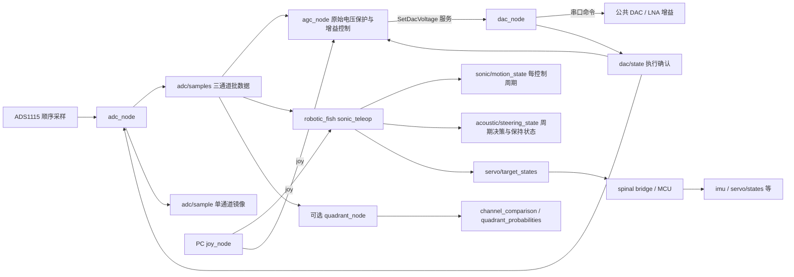

# ROS bag 记录梳理：exp20261022

本文的数据流、话题清单和数量描述本次调整前的源码及原始历史 bag，不是新版本发布清单。
当前已在声学包内移除 `adc/sample` 发布，并完成内部命名规范化；
实施范围与兼容规则见 [命名与数据出口约定](../naming_conventions.md)。
下文的运动数据重构等设计仍未实施，因为本轮不修改 `robotic_fish` 等其他包。

检查日期：2026-11-12。源码基线：`a28416b2`。原始数据目录：
`/home/dragon/Desktop/fish_rosbag/exp20261022`。

现场流程经用户确认：程序与系统持续运行，每次单项试验单独启动全量 rosbag 录制，
结束该项试验时停止录包，控制节点继续运行。一个 bag 是一次试验的记录窗口，
并不代表节点的一次启动或状态重置。

结论：当前声学控制链路的可观测性已经比较完整。话题较多符合全量录制方式，
不应据此推断录包入口混用。主要需整理的是全量数据的分层读取、时间基准、
持续运行会话与单项试验的关联，以及包内有效阶段／质量筛选。
建议保留原始全量录包流程，先补充试验元数据与统一离线读取规则。
本次仅增加审计材料、修正文档，没有改动控制算法、消息定义、launch 或原始 bag。

## 1. 检查范围与可复查证据

- 检查 `robotic_fish_sonic` 的驱动、校准、增益控制、固定窗口比较、周期趋声、
  状态显示、离线工具、消息／服务、配置、构建和启动关系，并核对相关测试覆盖与验证记录。
- 沿实际控制路径检查 `robotic_fish/scripts/sonic_teleop.py`、
  `sonic_vim4.launch`、`joy.launch`、`record.launch`，以及 spinal 的消息／桥接接口。
- 完整读取 7 个 bag，共 **812,684 条消息，128,813,184 字节（122.85 MiB）**。
  使用各 bag 内嵌消息定义，不依赖现场节点，不启动 ROS master 或硬件。
- 所有文件可正常完整遍历；各 bag 出现的 `robotic_fish_sonic` 消息 MD5
  与当前源码定义一致。语义仍以录入的配置版本为准，MD5 相同不保证控制参数相同。
- 逐消息审计结果、文件 SHA-256、话题连接与配置摘要：
  [exp20261022.json](exp20261022.json)；复查程序：[audit_bags.py](audit_bags.py)。

复查命令（从仓库根目录执行，使用具有 ROS1 rosbag 模块的 Python）：

```bash
python3 robots/robotic_fish_sonic/docs/rosbag_audit/audit_bags.py \
  /home/dragon/Desktop/fish_rosbag/exp20261022 \
  --output /tmp/exp20261022-audit-new.json
```

输出文件必须尚不存在。程序面向本批 bag 使用的当前字段，不能当作所有历史
12 字段／其他 schema 的通用适配器。JSON 的 `payload_bytes` 只统计序列化消息体，
不包括 bag 封装、索引和压缩；间隔大于 1 s、ROS／单调时钟差变化超过 50 ms
仅为审计标记，不直接等于丢包或硬件故障。

复核包括逐包消息计数对账、ADC 重复匹配、所有聚合日志的事件匹配、消息 MD5、
本地文档链接及 Python 3.8 语法检查；另用独立合成 bag 验证 1,000 s 时钟跳变、
日志转发序号变化与输入文件 SHA-256 保持不变。未重跑硬件控制测试或改变现场配置。

## 2. 当前系统的数据流与归属



代码提供的完整趋声实验入口是 `robotic_fish/sonic_vim4.launch`，
另有指定话题录制入口 `robotic_fish/record.launch`，均不在声学包内。
现场实际采用每项试验单独全量录包，并非使用这个指定话题 launch。
`sonic_vim4.launch` 本身不录包；`robotic_fish_sonic/sonic.launch`
只组合 IO 与固定窗口声学处理，不包含运动和录制。
`status_console.py` 只显示 Share 文本，不是记录器。

| 数据层 | 发布者与接口 | 离线用途与约束 |
| --- | --- | --- |
| 原始采集 | `/adc` → `adc/samples`，约 20 组/s | 每组 ADC0/1/2，每通道约 20 Hz；保留原始码、电压、校准质量和采样时间 |
| 单通道镜像 | `/adc` → `adc/sample`，约 60 条/s | 全量原包中保留；离线分析优先读取批数据，避免重复计数 |
| 硬件执行 | `/dac` → `dac/state` | 设置完成／通信失败时发布并锁存；不是模拟电压独立测量 |
| 增益模式 | `/gain_control` → `gain_control/state` | 状态变化时发布并锁存，不能要求它持续 20/50 Hz |
| IO 配置 | `/adc`、`/dac`、`/gain_control` → `gain_control/config` | 一个话题上有三个合法发布者；按 `device` 分开读取，保留配置变更历史 |
| 运动过程 | `/sonic_teleop_node` → `sonic/motion_state` | 约 50 Hz，含模式、相位、目标、Joy/ADC 年龄和质量；首次 Joy 前也有状态 |
| 周期决策 | 同节点 → `acoustic/steering_state` | 约 50 Hz 状态心跳；`decision_updated=true` 才是新的完整周期决策 |
| 控制配置／事件 | 同节点 → `sonic/config`、`acoustic/steering_events` | 配置锁存；事件仅发生时发布。`accepted` 不等于已经 `applied` |
| 人工查看 | 同节点 → `sonic/status_snapshot` | 按 Share 才发布的字符串，不用于替代连续数值记录 |
| 命令与反馈 | `servo/target_states`、`servo/states` | 分别是发送目标和下位机上报，不能互相代替；反馈可信性需另外验证 |
| 可选估计 | `/acoustic_quadrants` → 比较／概率 | 独立固定窗口路径，不参与周期趋声；没有模型时概率不可用 |

## 3. 7 个 bag 的实际清单

文件名保持原样；时间跨度来自 bag 索引，单调跨度来自首末运动状态的 `monotonic_s`。
单调跨度仅覆盖录到的运动过程，不能直接当作外部视频的绝对时间。

| bag | MiB | 话题数 | bag 跨度 s | 运动单调跨度 s | ADC 组数 | 校准回退组（比例） | 新周期决策数 |
| --- | ---: | ---: | ---: | ---: | ---: | ---: | ---: |
| `2026-10-21-23-07-32.bag` | 19.58 | 21 | 216.129 | 215.960 | 4,319 | 210（4.86%） | 44 |
| `2026-10-21-23-13-27.bag` | 19.33 | 21 | **40,986.275** | **214.640** | 4,294 | 881（20.52%） | 107 |
| `2026-10-22-10-44-24.bag` | 7.89 | 22 | 86.436 | 86.240 | 1,726 | 39（2.26%） | 101 |
| `2026-10-22-10-47-04.bag` | 39.69 | 21 | 439.939 | 439.680 | 8,794 | 158（1.80%） | 449 |
| `2026-10-22-10-57-01.bag` | 12.38 | 21 | 138.812 | 138.660 | 2,774 | 892（32.16%） | 85 |
| `2026-10-22-11-00-59.bag` | 14.84 | 22 | 165.177 | 165.000 | 3,301 | 501（15.18%） | 93 |
| `2026-10-22-11-03-50.bag` | 9.13 | 21 | 101.412 | 101.219 | 2,025 | 390（19.26%） | 71 |

合计运动单调跨度约 **1,361.40 s（22.69 min）**，不能将异常 bag 的
11.4 小时算进有效实验时长。7 个文件合计有 950 次新周期决策，
而 `steering_state` 有 68,081 条；二者表示的粒度不同。

### 所有实际话题及整理建议

以下数量是 7 个 bag 的总和。当前 `record.launch` 只订阅其中一部分，
现场采用全量录制，因此实际 bag 有更多话题是正常的；该 launch 的订阅表
不能代表现场全量命令的范围。下表的“保留／可选”用于组织分析视图或将来选择性录制，
不要求从全量原包删除数据。

| 话题（完整前缀 `/robotic_fish`，除非以 `/` 开头） | 总消息数 | 建议归属 |
| --- | ---: | --- |
| `adc/samples` | 27,233 | 核心采集，保留 |
| `adc/sample` | 81,698 | 原包保留；批数据分析时不重复读取 |
| `dac/state` | 75 | 核心执行状态，保留 |
| `gain_control/state` | 158 | 核心增益状态，保留 |
| `gain_control/config` | 65 | 核心配置，保留所有 device 的变化 |
| `sonic/motion_state` | 68,077 | 核心运动过程，保留 |
| `acoustic/steering_state` | 68,081 | 核心周期结果／当前动作，保留 |
| `sonic/config` | 9 | 核心控制配置，保留 |
| `acoustic/steering_events` | 2 | 核心事件，零条可能是正常情况 |
| `sonic/status_snapshot` | 460 | 人工快照，可选 |
| `/joy` | 43,999 | 核心操作者输入，保留 |
| `/servo/target_states` | 68,068 | 核心实际发送命令，保留 |
| `/servo/states` | 68,079 | 保留反馈原始记录，标注可信性限制 |
| `/diagnostics` | 5,395 | 保留硬件和采样故障证据 |
| `/rosout` | 383 | 保留模式／故障日志 |
| `/rosout_agg` | 173 | 原包保留；日志分析视图按事件去重 |
| `/imu` | 243,087 | 姿态／轨迹分析时录；类型是 `spinal/Imu` |
| `/baro` | 98,026 | 当前声学实验非核心，硬件排查可选 |
| `/battery_voltage_status` | 11,348 | 整机实验建议保留，非声学校准必需 |
| `/servo/torque_states` | 1,361 | 执行器排查或需解释使能状态时保留 |
| `/motor_pwms` | 13,453 | 飞控／推进排查可选，不能当作本次单尾舵位置命令 |
| `/rpy/pid` | 13,454 | 飞控排查可选 |

历史录制日志还列出了 `/gps`、`/servo/extended_states`、`/flight_config_ack`、
`/rpy/feedback_state`、`/esc_telem` 等订阅，这些话题没有实际消息。
“订阅列表有它”和“bag 中有数据”必须区分。历史日志证明录制范围更宽，
这与用户说明的全量录制一致；仅凭日志不能还原命令原文。

## 4. 优先处理的问题

### P1：ROS 时间跳变和跨主机时间不一致

`23-13-27.bag` 中，相邻运动消息为：

| 时钟 | 前一条 | 后一条 | 差值 |
| --- | ---: | ---: | ---: |
| `header.stamp`（Unix s） | 1792595802.511432 | 1792636573.900053 | 40,771.388620 s |
| `monotonic_s` | 3589.638987 | 3589.654967 | 0.015980 s |

ROS 与单调时钟的偏移改变了 **40,771.372640 s（约 11 h 19 min 31 s）**。
该位置的控制记录出现 `acoustic_clock_changed`，不是简单的“中间没采集”。
这足以确认 ROS 时钟基准突变；是否由 NTP／人工校时造成，bag 本身不能确定。

第一包 `/joy` 的 `bag_record_time-header.stamp` 中位数约 **−40,770.03 s**，
也说明主机间存在很大的时间基准差异。这不是可以解释成负数的网络传输延迟。
即使在后续 bag，Joy 消息时间与接收时间也不能混为一谈。

处理：

1. 把异常 bag 按 ROS／单调时钟偏移变化划成两个 clock epoch，保留原文件。
2. 运动过程用本节点 `monotonic_s` 计算相对时间；ADC 与运动只在已验证的同一
   epoch 内关联，不能跨跳变点套一个全局时间差。
3. 多机绝对时间对齐前先核验 PC／VIM4 时钟，录制中避免 step 校时；
   记录主机、时区和同步状态。这里不自动修改机器时钟。
4. 文件名对应的钟面时间与 bag UTC 时间呈 UTC+08:00 关系。
   例如 `10-44-24` 的实际起点是 `02:44:24Z`，换成东京时间是 `11:44:24+09:00`。
   这是可观察的偏移，不据此断定现场时区配置，更不能按文件名直接对齐视频。

### P1：校准回退与保护过程混在实验数据中

27,233 组 ADC 中 **3,071 组（11.28%）**至少一个通道校准失败。
当前代码采用整组回退：`status_cali=false` 时 `volt_cali` 回到 `volt_raw`，
因此 `volt_cali` 是有限数并不代表校准成功。诊断中可见超出旧校准表支持范围的原因。

本批均使用旧表 `adc_independent_transfer_2026-09-27-13-51-52`，
范围分别约为 ADC0 0.01175–3.26569 V、ADC1 0.01225–3.18756 V、
ADC2 0.02075–3.27638 V；当前默认表已经是 11 月新电路版本。
历史结果应先用录入的旧表和标志解释；新表只有在确认硬件／实验条件适用时
才能另做重处理，且应标明派生版本，不能覆盖历史已录的电压。

审计还发现 5 个混合增益采样组、原始峰值最高 4.05250 V。
没有发现三通道缺失／重复、逐通道采样序号断档、逐通道时间倒退或 ADC 满量程饱和码。
这些检查不等于证明模拟前端无削波，也不保证采样到全部连续物理信号。

离线提取时分别保存 `raw_valid`、`calibration_valid`、`gain_known`、
`gain_stable`、`decision_current`，不要只有一个笼统的 `valid`。
回退／保护数据仍用于排障，统计有效趋声判据时按质量规则筛选。

### P2：重复记录与粒度混用

- 批数据包含 81,699 个单通道 sample，其中 **81,697 个**与独立 `adc/sample`
  序列化内容逐字节相同。仅第一包有 1 条单通道独有记录，`10-57-01` 包有 2 个
  批数据内 sample 未在单通道话题找到；原因未确定。两个订阅不能被当作独立观测。
- 所有 173 条 `/rosout_agg` 日志都能在 `/rosout` 找到相同事件；转发时
  `header.seq` 改变，所以不是原始字节完全相同，按事件语义去重。
- 单通道镜像占总序列化消息体约 **11.50%**。这是消息体占比，
  不是承诺 bag 文件能精确缩小同样比例。
- 50 Hz 的 steering 状态大多沿用上一周期结果。
  `decision_updated=true` 提取每周期的新决策；`decision_current=true`
  描述当前决策有效，`has_decision=true` 单独使用可能读到已停止时的历史结果。
- 不同话题的计数相差几条不直接说明丢包。状态／命令发布队列、录制边界与
  独立订阅都有影响；逐条关联应使用时间与原消息字段，不能按行号 zip。

不要为了精简把 `steering_state` 只在更新时录下来：当前状态中的
holding／warmup／stopped 以及保留旧偏置的过程仍有分析价值。
先在导出层分别生成“控制时序表”和“每周期决策表”。

### 分析规则：单项试验内部仍需区分模式与生效参数

运动状态中 `stopped` 有 21,065 条，约占 **30.94%**；其中有手动停止、
Joy 超时和时钟异常。不能把整包都当成有效趋声实验，也不能把 stopped 比例当作丢包率。

所有 bag 的配置均为 1.5 Hz、阈值 0.15、
`difference_reference=channel_mean`、`voltage_offset_reference=left_minus_right`、
`left_bias_sign=-1`。偏置幅值不同：

| bag | 录到的生效 bias／待生效请求 |
| --- | --- |
| 前两包 | 128，无待生效请求 |
| `10-44-24` | 开始时 256，已有待生效 request 2（512）；包内 applied 到 512 |
| `10-47-04`、`10-57-01` | 512 |
| `11-00-59` | 开始时 512，已有待生效 request 3（256）；包内 applied 到 256 |
| `11-03-50` | 256 |

两次 applied 事件的 accepted 发生在录包前；初始锁存配置保存了 pending request，
所以这不是“缺少 accepted 就说明事件丢失”。事件为零的 bag 也可能完全正常。
ADC／DAC／gain 三份初始锁存配置和 sonic 配置在各包都有记录。

分段键建议为 `session_id + trial_id + clock_epoch + motion_segment + effective_config`。
`cycle_index` 在每次新跟踪过程内可重置，`request_id` 属于运动进程，
都不能单独当作跨 bag 的全局唯一主键。跨文件还需用进程启动时间关联。

持续运行流程下，分开两个层次：`session_id` 表示一次持续运行会话，
`trial_id` 表示一次单项试验／录包；同一 session 可以有多个 trial，
trial 起点不能当作进程启动时间。
实际配置证明，后六包的运动进程具有相同的 `host=vim4`、
`started_ros_s=1792595596.6833751` 和 `started_monotonic_s=3383.810923195`；
第一包的运动进程启动标识不同。这里仅确认运动进程的连续性，
不据此断定其他所有节点也从未重启。

因此，bag 开始时继承上一项试验的模式、偏置、DAC、历史决策或待生效请求是正常现象；
不能假定它们都从零开始。锁存消息的 source time 早于 bag 起点也可能是正常的。
在每个 trial 起点按 device/process 读取已锁存配置与状态，再应用包内变更。
非锁存事件在两次录包之间发生时不会被下一包补录，试验前必须确认当前有效配置，
而不是要求下一包必然包含此前的事件链。

### P2：反馈、配置与文档的含义容易误读

- `/imu` 是 `spinal/Imu`，使用 `stamp`，不是 `sensor_msgs/Imu.header.stamp`。
  `AdcSampleArray` 没有整体 header；三通道的采样时间相差约 19.6–19.7 ms，
  应使用各 sample 时间，不能假定同步采样。硬件 `data_rate=128 SPS`
  也不是每通道实际发布频率。
- 第一包舵机状态 10,799 条中，`temp=255` 有 6,354 次，`error=127` 有 5,745 次。
  多包也有类似极端字段。仅凭 bag 不能确定是驱动、协议或真实故障，
  在核验固件／硬件前不能直接用这些值得出物理温度、电流或闭环跟踪精度。
- 配置话题中 ADC、DAC、gain 共用一个地址是现有设计；
  “只取最后一条 config”会丢掉其他设备的配置。
- `dac_volt` 的反馈标记表示软件执行确认／串口回显，不是独立 ADC 回读。
  当前非法 DAC 参数只通过服务返回失败，不会覆盖已确认状态；
  rosbag topic 无法完整记录所有服务调用。确需审计每次拒绝时，再增加明确的请求／结果事件。
- `docs/io_reference.md` 原先还写着“8 个录制话题／诊断 opt-in／非法 DAC 请求使状态失效”，
  与当前源码不符，本次已修正相关段落。实际行为以源码与当前 README 为准。

## 5. 建议的录制组织方式

### 5.1 保留每项试验的全量原包，按用途建立分析视图

现阶段继续全量录制，无需为了减少话题而改变现场操作或重启系统。
整理重点是统一选取数据：趋声分析默认读取以下核心 13 个话题，其余按需关联。

```text
/robotic_fish/adc/samples
/robotic_fish/dac/state
/robotic_fish/gain_control/state
/robotic_fish/gain_control/config
/robotic_fish/sonic/motion_state
/robotic_fish/acoustic/steering_state
/robotic_fish/sonic/config
/robotic_fish/acoustic/steering_events
/joy
/servo/target_states
/servo/states
/diagnostics
/rosout
```

| 分析视图 | 读取原则 |
| --- | --- |
| 日常趋声 | 核心 13 个；整机电池状态建议附加；Share 文本按需 |
| 姿态／运动分析 | 日常集合加 `/imu`；有外部定位／视频时记录同步依据与文件映射 |
| 固定窗口测向 | 加 `channel_comparison`；启用真实模型时加 `quadrant_probabilities` 及模型快照 |
| ADC 校准／硬件排查 | ADC 批数据、DAC、gain 状态和配置、diagnostics、rosout 为基础；排查单通道传输时再比较 `adc/sample` |

这是待实施的离线视图设计，不会限制原包内容。当前 `record.launch` 仍保持
原有 17 个订阅（包括 Share、IMU 和可选固定窗口话题），它是可选的精简录制入口，
不是本批数据的实际录制入口。只有后续测得存储／带宽压力时，再评估选择性录制。
不建议立即重命名所有 topic 或更换消息。

### 5.2 持续运行会话下，每项试验建立目录与 manifest

```text
fish_rosbag/
  20261022/
    session_002/
      session.yaml            # 运行主机、进程启动标识、硬件与代码版本
      trial_003_tracking_bias512/
        manifest.yaml         # 单项试验目的、条件、录制窗口、有效阶段
        raw/sonic_20261022T024424Z.bag
        config/               # 该项试验实际生效／待生效配置
        derived/              # 派生表与质量摘要；全量原包只读
```

manifest 至少记录：`session_id`、`trial_id`、实验目的、UTC 起止时间和现场时区、
录制主机、PC／VIM4 角色、代码提交及是否有未提交修改、录制集合、bag SHA-256、
硬件／电路版本、校准 ID 与文件哈希、声源设置与相对位置、参数改变、
clock epoch／异常、外部视频和实验备注。未知值明确写 `null`，不要事后从声压数据猜实验条件。
bag 中已有完整校准快照；外置快照主要便于检索，不替代有效运行配置。
每项试验记录准备、有效试验开始／结束、收尾等阶段；不要求阶段边界正好等于
rosbag 进程起止。不同 trial 默认继承系统状态，只有实际执行了复位才标记已复位。

命名整理应通过新目录与清单映射实施，先保留历史文件名和哈希；
本次没有重命名、移动或过滤原始数据。

### 5.3 导出 5 张不同粒度的表

| 表 | 一行代表什么 | 关键字段 |
| --- | --- | --- |
| `adc_samples` | 一个通道的一次转换 | bag、epoch、channel、serial、sample time、raw code/voltage、calibrated voltage、quality、DAC |
| `motion_ticks` | 一个 50 Hz 控制时刻 | process/segment、ROS/monotonic time、模式、相位、实际发布命令、偏置与输入年龄 |
| `steering_cycles` | 一次 `decision_updated` | segment/cycle、窗口、样本数、三通道均值、补偿前后判据、方向、偏置、有效参数 |
| `configs_events` | 一次配置快照或事件 | device/process/request、source/record time、active/pending/applied、完整 JSON |
| `feedback` | 一次下位机上报 | 原始时间、类型与原始字段、质量限制；不自动伪装成已校验物理量 |

不同数据使用自己的时间键。首次导出可将 sample 原始整数秒／纳秒一起保留，
避免大 Unix 时间用浮点数往返时丢失纳秒精度；导出层再做明确的最近邻／窗口关联。
按周期抽样的均值与高频控制状态不要放到同一张表后统计成同等独立样本。

### 5.4 录前／录后检查与实施次序

1. **保留当前操作，补齐标识**：程序持续运行，每项试验单独全量录包；
   为 session/trial、输出目录和实验条件建立明确记录，区分录制窗口与有效试验阶段。
2. **优先治理时钟**：录前比较多机时间与同步状态，录后报告 clock step、
   每话题时间分布和运动单调跨度；异常先分段，不能靠改文件名修复。
3. **增加 manifest 和质量摘要**：检查 ADC 三通道结构、逐通道时间／序号、
   回退／混合增益／饱和、控制间隔、停止原因、必需配置快照、派生文件版本。
4. **统一离线导出与分析视图**：保持全量原包和现有消息结构，分析时去重，
   将实验时序／周期决策／反馈分开；按 session 关联跨 bag 配置与进程。
   是否精简录制、压缩或分包，再按实际磁盘吞吐与存储需求决定。

`replay_quadrants.py` 重算的是固定窗口比较／可选模型输出，
不等于复现这批在线周期趋声决策；`calibrate_from_bag.py --common-input`
要求已确认共同电输入，不能对自由游动趋声数据直接生成校准表。

本文给出了全量记录的分层读取与导出设计，尚未实现新的分析视图、manifest 写入器、分段修复器或导出器。
也未将这 7 包作为声源定位精度／趋声成功率的验证：缺少声源真值、实验备注与已校验运动反馈，
不能从记录本身补出这些结论。
